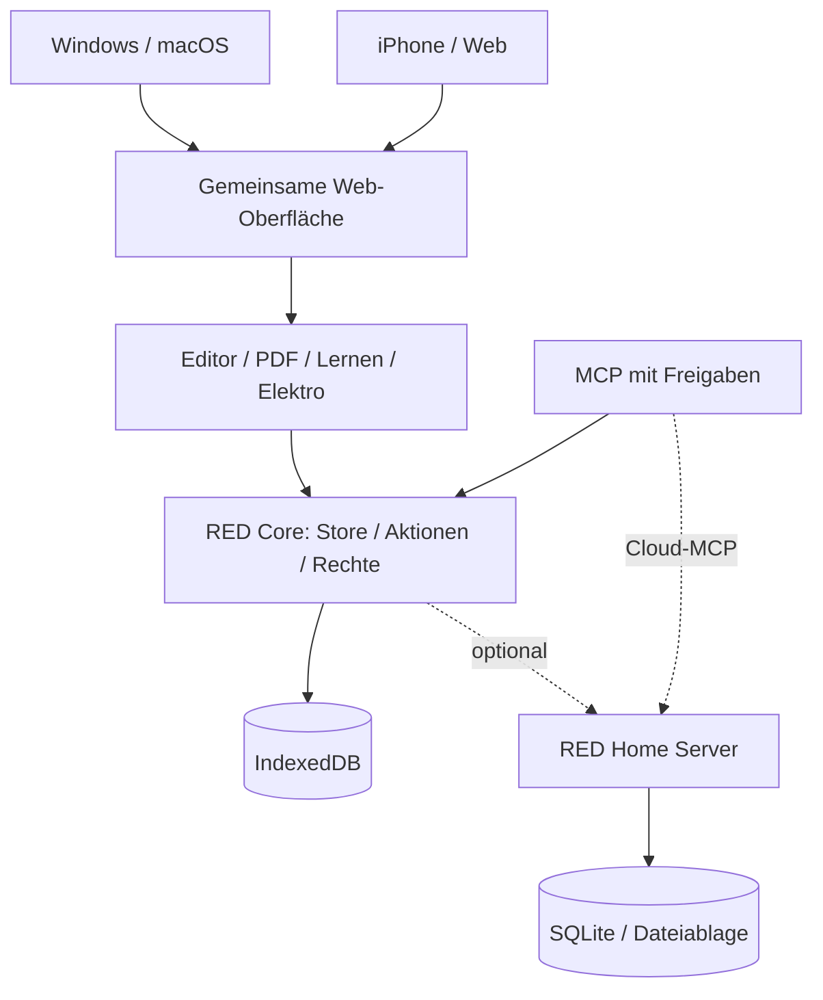

# RED ION

**Dein lokaler Arbeitsbereich für Wissen, Schule, Elektrotechnik und Projekte.**

RED ION verbindet Dokumente, Notizen, Datenbanken, PDF-Studio, Zeichnen, Lernwerkzeuge und Elektrotechnik in einer gemeinsamen Anwendung. Deine Daten liegen zuerst auf deinem Gerät. Ein eigener RED Home Server ist optional.

[Start](#schnellstart) · [Funktionen](#funktionen) · [Architektur](#architektur) · [Entwicklung](#entwicklung) · [Sicherheit](#sicherheit) · [Roadmap](#roadmap)

## Schnellstart

| Plattform | Einstieg | Voraussetzung |
|---|---|---|
| Offline / Browser | `index.html` oder `redion-einzeldatei.html` öffnen | Kein Konto, keine Installation |
| Windows | [Releases](https://github.com/Redurbabat/Redion/releases) bzw. [Actions](https://github.com/Redurbabat/Redion/actions) | Electron-Paket; Preview ist kein signiertes Release |
| macOS | [Desktop-Anleitung](doku/PLATTFORM-STRATEGIE-MAC-WINDOWS-IPHONE.md) | macOS-Build; Signierung separat |
| iPhone | [iPhone-Integration](doku/IPHONE-WINDOWS-INTEGRATION.md) | Signierte IPA oder Web-App; native Installation separat |
| Eigener Server | [RED Home Server](doku/HOME-SERVER.md) | Node 24 / Docker, private Datenablage, HTTPS |

Für die normale Offline-Nutzung ist kein Build nötig. Für Entwicklung Node.js ab 22.18 verwenden, für die Server- und neuen Werkzeugtests Node 24 empfohlen.

## Funktionen

| Bereich | Vorhandener Funktionsumfang |
|---|---|
| Workspace | Blockeditor, Bibliothek, Seiten, Aufgaben, Wiki, Kalender, Tabellen und Datenbankansichten |
| RED Studio | PDF-Werkzeuge, Stift, Whiteboard, Mindmaps, Desktop-Inspektoren und native Fenstermenüs |
| Lernen | Lernkarten, Fehlertraining, Lernpfade, Prüfungsplanung, Quellverknüpfungen |
| Elektro | Schaltpläne, Relaiswerkstatt, Simulation und berechnete Messwerte; kein Ersatz für reale Sicherheitsprüfungen |
| Dateien | Lokale Anhänge in Stücken, Import/Export, .redion-Archive einschliesslich ZIP64 |
| KI | Lokale KI-Anbindungen, Agentenregeln; Modelle/Dienste müssen separat verfügbar sein |
| MCP | Lokaler Windows-Adapter und Cloud-MCP mit OAuth und abgestuften Rechten |
| RED Home Server | SQLite, private Gerätefreigabe, Sync-Pilot, Dashboard, Backup und Vault-Bausteine |
| RED Ecosystem | RED ID, SDK 0.15, Geräteverwaltung, Share, Files, Config, Search, Clipboard, App Center, lokale AI-/MCP-Hub-Piloten |

Der Desktop-Stand aus [PR #262](https://github.com/Redurbabat/Redion/pull/262) enthält die Integration von #258 und #261. Der Integrations-Commit bestand sieben Workflows bzw. 13 Checks. Eine isolierte, unsignierte Windows-Vorschau wurde gebaut. Das ist kein Nachweis für die aktuelle Revision oder einen laufenden Heimserver.

## Architektur



Schematische Zielrichtung mit vorhandenen Komponenten; die lokalen und serverseitigen MCP-Pfade haben unterschiedliche Verträge.

| Pfad | Zuständigkeit |
|---|---|
| `src/` | Autoritativer TypeScript-/TSX-Quellcode der Web-App |
| `quell/` | Versionierte generierte Offline-Ausgabe, nicht manuell ändern |
| `server/`, `deploy/home/` | Cloud- und private Serverdienste, Docker |
| `red-sdk/` | Gemeinsame SDK-Verträge und native Identitätsbibliotheken |
| `windows/`, `ios/` | Plattformintegration und Build |
| `plugins/red-ion/` | Lokaler MCP-Adapter |
| `pruefungen/`, `tools/` | Tests und Entwicklerwerkzeuge |
| `doku/` | Architektur, Abnahme, Sicherheits- und Bedienungsanleitungen |

IndexedDB hält Blöcke, Sammlungen, Ansichten, Metadaten, Versionen, Dateien und Dateistücke sowie Abgleichsbasis, Cache, Suchindex und Aufträge. Ein Server ist nicht Voraussetzung für die lokale Datenhaltung.

## Entwicklung

```sh
npm ci
npm run typecheck
npm run bauen:ts
node bauen.mts
npm run stand
npm run pruefen -- --schnell
```

Die Schnellprüfung ersetzt den vollständigen Browserlauf nicht. Für Browserprüfungen zuerst `npx playwright install chromium` ausführen. Vollständiger Lauf: `node pruefungen/volllauf.mts`.

Lokaler Prüfserver: `npm run server` (Port 8790). Ordnerbericht: `npm run struktur:bericht`. MCP: `npm run test:mcp-cloud`, `npm run test:mcp-connector`. Native Windows-Builds und iOS-Signierung siehe die jeweiligen Plattformanleitungen.

### Neue isolierte Entwicklungsbausteine

- RED Video Preview: `node tools/red-video-preview.mts eingabe.json ausgabe.html` – eine validierte animierte Offline-HTML-Timeline, noch kein MP4-Renderer.
- RED Developer Check: `node tools/red-developer-check.mts` – liest Projektbestand und Node-Version, startet keinen Build und keine externen Programme.
- RED Sync: isolierter verschlüsselter SQLite-Adapter mit atomarem Cursor und Konfliktjournal (Node-Pilot, noch keine native App-Integration).
- RED Files: optionaler Node-Dateisink für expliziten Klartext-Export in ein vertrauenswürdiges Zielverzeichnis, mit temporärer Ablage und Veröffentlichung ohne Überschreiben.

Details und Testbefehle: [RED ION Entwicklungsphase 3](doku/RED-ION-PHASE-3.md).

## Sicherheit

- Offline zuerst. Normale IndexedDB-Inhalte und Klartextexporte sind nicht pauschal verschlüsselt.
- Private Sync-/Share-Objekte und ausgewählte Vault-/Backup-Pfade unterstützen AES-GCM. Schlüsselverwaltung und vollständige E2EE-Abnahme sind noch offen.
- RED Files bleibt ein Pilot: höchstens 8 MiB pro Datei, 16 MiB kodierte Daten und 1024 Objekte pro Konto; Streaming-Download erhöht die Quoten nicht.
- Private Serverdienste nur mit geprüfter HTTPS-Konfiguration und bewusst erteilten Berechtigungen betreiben. Keine öffentliche Registrierung oder automatische Datenfreigabe.
- Ein lokales KI-Modell und OCR-Dienst sind optional. Externe Anbieter können Daten erhalten, wenn sie ausdrücklich genutzt werden.
- MCP- und KI-Aktionen brauchen passende Freigaben. Keine allgemeine Shell- oder Dateisystemfreigabe.
- Der Zugangscode zur historischen Chronik ist keine wirksame Zugangskontrolle. Öffentliches Repository vor produktiver Bereitstellung auf private Dateien und Deployment-Ausschlüsse prüfen.

**Backup vor Update.** Ein .redion-Export ist standardmässig kein verschlüsselter Tresor. Wiederherstellung regelmässig mit einer getrennten Testablage prüfen.

## Roadmap

[Gemeinsamer Master-Auftrag für alle vier offenen Issues](doku/RED-ION-MASTER.md).

| Arbeitsbereich | Nächste Abnahme |
|---|---|
| RED Core | Messbare Startzeit, Speicherverbrauch, Fehler- und Datenintegrität |
| RED Storage / Sync | Grosse verschlüsselte Dateien, sichere Schlüsselverteilung und echte iPhone-/Windows-Synchronisation |
| RED MCP 2.0 | Vollständiger Aktionskatalog, Vorschau, Rechte und Undo |
| RED Studio | Echte parallele Editoren, Mehrfenster-, Stift- und Monitorabnahme |
| Elektro Studio | Erweiterte Modellprüfungen, Messinstrumente, Lernaufgaben |
| RED Video | Timeline-Pilot zu Rendering, Audio und später MP4 ausbauen |
| RED AI | Modell-Router, lokale/externe Einwilligung und strukturierte Ergebnisse |
| RED Developer | Build-Diagnose, kontrollierte Agenten- und Release-Verwaltung |

Keine der offenen Zielstufen gilt als abgeschlossen, nur weil Code oder ein Test dafür existiert. Eine Freigabe benötigt erfolgreiche relevante CI auf dem tatsächlichen Commit und für native Funktionen eine separate Geräteabnahme.

## Dokumentation

[Architektur](doku/ARCHITEKTUR.md) · [Ordner und Build](doku/ORDNER-UND-BUILD-STRUKTUR.md) · [Desktop](doku/RED-STUDIO-DESKTOP.md) · [Elektro](doku/ELEKTRO-STAND.md) · [MCP](doku/RED-ION-MCP-ARCHITEKTUR.md) · [Home Server](doku/HOME-SERVER.md) · [SDK](red-sdk/README.md) · [.redion-Format](doku/REDION-FORMAT.md) · [Agentenregeln](AGENTS.md)

Die [frühere ausführliche README](https://github.com/Redurbabat/Redion/blob/67876aa2916bf7d6d2c34c884184060ac9c1ba7e/README.md) bleibt als historische Bedienungsreferenz in Git erhalten. Ihre älteren Status- und Cloud-Aussagen sind keine aktuellen Betriebsnachweise. Die aktuelle README ersetzt diese Statusübersicht, nicht die Fachanleitungen.

**Grundsatz:** Datenintegrität vor neuen Funktionen. Offline vor Cloud. Prüfungen vor Freigabe.
