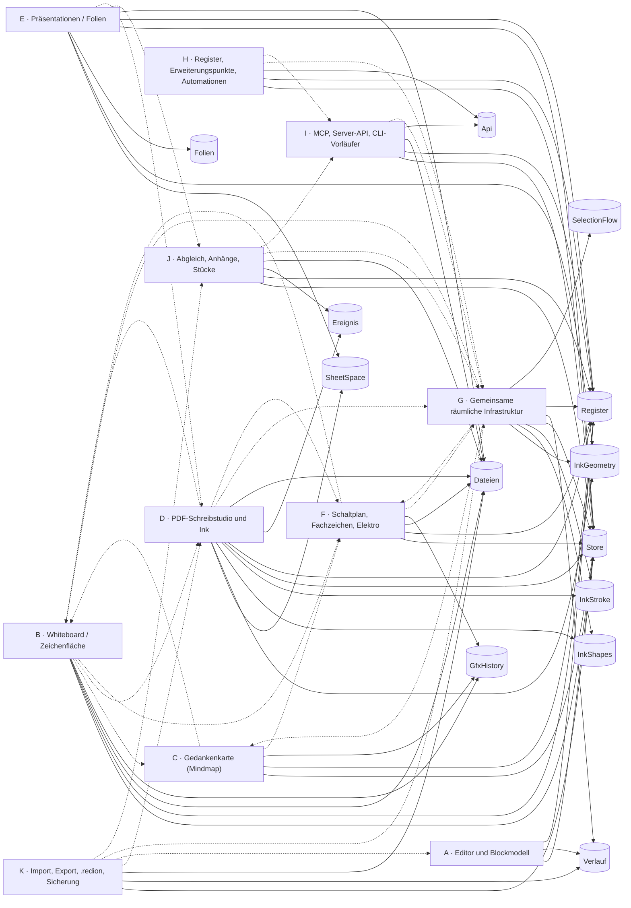

<!-- ERZEUGT — NICHT VON HAND ÄNDERN.
     Die Quelle ist doku/karte/karte.json. `node karte.mts` schreibt diese Datei neu;
     was hier von Hand geändert wird, ist beim nächsten Lauf weg. -->

# Redion — die Karte des Quelltexts

Stand 25. September 2026 · HEAD `1b89c01` · 11 Systeme · 13 gemeinsame Kerne · 2 Referenzen

Gebaut beim Plattform-Audit (doku/REDION-PLATTFORM-AUDIT.md). Jeder Befund trägt Datei:Zeile; was ein Leser nicht fand, steht als „nicht gefunden“ da. Die Karte ersetzt das Lesen nicht — sie sagt, WO man lesen muss. Nachgetragen wird in karte.json, nicht in den Notizen — zuletzt E686 (Whiteboard).

## Der Graph

Ein Pfeil zu einem Kern heisst: der Befund belegt, dass das System ihn BENUTZT. Ein gestrichelter Pfeil zu einem System heisst: dort liegt ein belegtes Duplikat. Was ein System nur nennt, ohne es zu benutzen, steht in seiner Notiz unter „Gemeinsam genutzt".

## Die Systeme

| Notiz | Hauptdateien | Prüfläufe | Duplikate | nutzt |
|---|---|---|---|---|
| [[editor|A · Editor und Blockmodell]] | `editor.ts`, `auswahlleiste.ts`, `mehrfach.ts` +6 | 21 | 5 | [[kern-Store|Store]], [[kern-Verlauf|Verlauf]], [[kern-Register|Register]] |
| [[zeichenflaeche|B · Whiteboard / Zeichenfläche]] | `zeichenflaeche.ts`, `werkzeuge.css`, `editor.ts` +9 | 7 | 6 | [[kern-Store|Store]], [[kern-Register|Register]], [[kern-Dateien|Dateien]], [[kern-GfxHistory|GfxHistory]] |
| [[gedankenkarte|C · Gedankenkarte (Mindmap)]] | `gedankenkarte.ts`, `werkzeuge.css`, `bloecke.ts` +4 | 4 | 7 | [[kern-Store|Store]], [[kern-Register|Register]], [[kern-GfxHistory|GfxHistory]] |
| [[pdf|D · PDF-Schreibstudio und Ink]] | `marken.ts`, `document-mode.ts`, `seite.ts` +9 | 24 | 6 | [[kern-SheetSpace|SheetSpace]], [[kern-InkGeometry|InkGeometry]], [[kern-InkShapes|InkShapes]], [[kern-InkStroke|InkStroke]], [[kern-Store|Store]], [[kern-Register|Register]], [[kern-Ereignis|Ereignis]], [[kern-Dateien|Dateien]] |
| [[folien|E · Präsentationen / Folien]] | `folien.ts`, `folien.ts`, `einlesen.ts` +7 | 30 | 5 | [[kern-SheetSpace|SheetSpace]], [[kern-InkGeometry|InkGeometry]], [[kern-Folien|Folien]], [[kern-Store|Store]], [[kern-Register|Register]], [[kern-Dateien|Dateien]] |
| [[elektro|F · Schaltplan, Fachzeichen, Elektro]] | `schaltplan.ts`, `planflaeche.ts`, `fachzeichen.ts` +8 | 21 | 5 | [[kern-Store|Store]], [[kern-Register|Register]], [[kern-Dateien|Dateien]], [[kern-GfxHistory|GfxHistory]] |
| [[gemeinsam|G · Gemeinsame räumliche Infrastruktur]] | `selection-flow.ts`, `geometry.ts`, `shapes.ts` +7 | 36 | 11 | [[kern-InkGeometry|InkGeometry]], [[kern-InkShapes|InkShapes]], [[kern-InkStroke|InkStroke]], [[kern-Store|Store]], [[kern-Verlauf|Verlauf]], [[kern-Register|Register]], [[kern-SelectionFlow|SelectionFlow]] |
| [[register|H · Register, Erweiterungspunkte, Automationen]] | `befehle.ts`, `bloecke.ts`, `eigenschaften.ts` +27 | 28 | 8 | [[kern-Store|Store]], [[kern-Register|Register]], [[kern-Api|Api]] |
| [[mcp|I · MCP, Server-API, CLI-Vorläufer]] | `schnittstelle.ts`, `sw.ts`, `befehle.ts` +21 | 33 | 8 | [[kern-Store|Store]], [[kern-Register|Register]], [[kern-Dateien|Dateien]], [[kern-Api|Api]] |
| [[sync|J · Abgleich, Anhänge, Stücke]] | `maschine.ts`, `zusammenfuehren.ts`, `ablage.ts` +7 | 20 | 6 | [[kern-Store|Store]], [[kern-Register|Register]], [[kern-Ereignis|Ereignis]], [[kern-Dateien|Dateien]] |
| [[export|K · Import, Export, .redion, Sicherung]] | `indexdb.ts`, `schale.ts`, `umzuege.ts` +15 | 43 | 7 | [[kern-Store|Store]], [[kern-Verlauf|Verlauf]], [[kern-Dateien|Dateien]] |

## Die gemeinsamen Kerne

| Kern | Datei | benutzt von |
|---|---|---|
| [[kern-SheetSpace|SheetSpace]] | `src/core/sheet/space.ts` | [[pdf|D · PDF-Schreibstudio und Ink]], [[folien|E · Präsentationen / Folien]] |
| [[kern-InkGeometry|InkGeometry]] | `src/core/ink/geometry.ts` | [[pdf|D · PDF-Schreibstudio und Ink]], [[folien|E · Präsentationen / Folien]], [[gemeinsam|G · Gemeinsame räumliche Infrastruktur]] |
| [[kern-InkShapes|InkShapes]] | `src/core/ink/shapes.ts` | [[pdf|D · PDF-Schreibstudio und Ink]], [[gemeinsam|G · Gemeinsame räumliche Infrastruktur]] |
| [[kern-InkStroke|InkStroke]] | `src/core/ink/stroke.ts` | [[pdf|D · PDF-Schreibstudio und Ink]], [[gemeinsam|G · Gemeinsame räumliche Infrastruktur]] |
| [[kern-Folien|Folien]] | `src/core/slides/folien.ts` | [[folien|E · Präsentationen / Folien]] |
| [[kern-Store|Store]] | `src/kern/ablage/indexdb.ts` | [[editor|A · Editor und Blockmodell]], [[zeichenflaeche|B · Whiteboard / Zeichenfläche]], [[gedankenkarte|C · Gedankenkarte (Mindmap)]], [[pdf|D · PDF-Schreibstudio und Ink]], [[folien|E · Präsentationen / Folien]], [[elektro|F · Schaltplan, Fachzeichen, Elektro]], [[gemeinsam|G · Gemeinsame räumliche Infrastruktur]], [[register|H · Register, Erweiterungspunkte, Automationen]], [[mcp|I · MCP, Server-API, CLI-Vorläufer]], [[sync|J · Abgleich, Anhänge, Stücke]], [[export|K · Import, Export, .redion, Sicherung]] |
| [[kern-Verlauf|Verlauf]] | `src/kern/zustand/verlauf.ts` | [[editor|A · Editor und Blockmodell]], [[gemeinsam|G · Gemeinsame räumliche Infrastruktur]], [[export|K · Import, Export, .redion, Sicherung]] |
| [[kern-Register|Register]] | `src/register/*.ts` | [[editor|A · Editor und Blockmodell]], [[zeichenflaeche|B · Whiteboard / Zeichenfläche]], [[gedankenkarte|C · Gedankenkarte (Mindmap)]], [[pdf|D · PDF-Schreibstudio und Ink]], [[folien|E · Präsentationen / Folien]], [[elektro|F · Schaltplan, Fachzeichen, Elektro]], [[gemeinsam|G · Gemeinsame räumliche Infrastruktur]], [[register|H · Register, Erweiterungspunkte, Automationen]], [[mcp|I · MCP, Server-API, CLI-Vorläufer]], [[sync|J · Abgleich, Anhänge, Stücke]] |
| [[kern-SelectionFlow|SelectionFlow]] | `src/schale/bedienung/selection-flow.ts` | [[gemeinsam|G · Gemeinsame räumliche Infrastruktur]] |
| [[kern-Ereignis|Ereignis]] | `src/kern/ereignisse/bus.ts` | [[pdf|D · PDF-Schreibstudio und Ink]], [[sync|J · Abgleich, Anhänge, Stücke]] |
| [[kern-Dateien|Dateien]] | `src/bereiche/dateien/ablage.ts` | [[zeichenflaeche|B · Whiteboard / Zeichenfläche]], [[pdf|D · PDF-Schreibstudio und Ink]], [[folien|E · Präsentationen / Folien]], [[elektro|F · Schaltplan, Fachzeichen, Elektro]], [[mcp|I · MCP, Server-API, CLI-Vorläufer]], [[sync|J · Abgleich, Anhänge, Stücke]], [[export|K · Import, Export, .redion, Sicherung]] |
| [[kern-Api|Api]] | `src/bereiche/verbinden/schnittstelle.ts` | [[register|H · Register, Erweiterungspunkte, Automationen]], [[mcp|I · MCP, Server-API, CLI-Vorläufer]] |
| [[kern-GfxHistory|GfxHistory]] | `src/core/gfx/history.ts` | [[zeichenflaeche|B · Whiteboard / Zeichenfläche]], [[gedankenkarte|C · Gedankenkarte (Mindmap)]], [[elektro|F · Schaltplan, Fachzeichen, Elektro]] |

## Die Referenzen (nur gelesen, nichts übernommen)

- [[referenz-siyuan|SiYuan]] — AGPL-3.0 — keine Codeübernahme möglich
- [[referenz-affine|AFFiNE / BlockSuite]] — MIT (blocksuite, framework/std); packages/backend unter eigener Lizenz — nicht übernommen

## Die Themen (quer durch die Systeme)

- [[thema-werkzeugleisten|Die vier Werkzeugleisten — das „Vorher" für W6]] — Stand 25. September 2026, ein Leser für Bogen 5 (E681-Karte, Zeilen am HEAD 0b19a34 nachgesehen)

## Wie die Karte gepflegt wird

Quelle ist `doku/karte/karte.json`; `node karte.mts` schreibt alle Notizen neu, `node karte.mts --pruefen` sagt nur, ob sie stimmen. Ein neuer Befund kommt ins JSON, nicht in eine Notiz. Wer ein System umbaut, trägt es dort nach — sonst lügt die Karte beim nächsten Mal.
