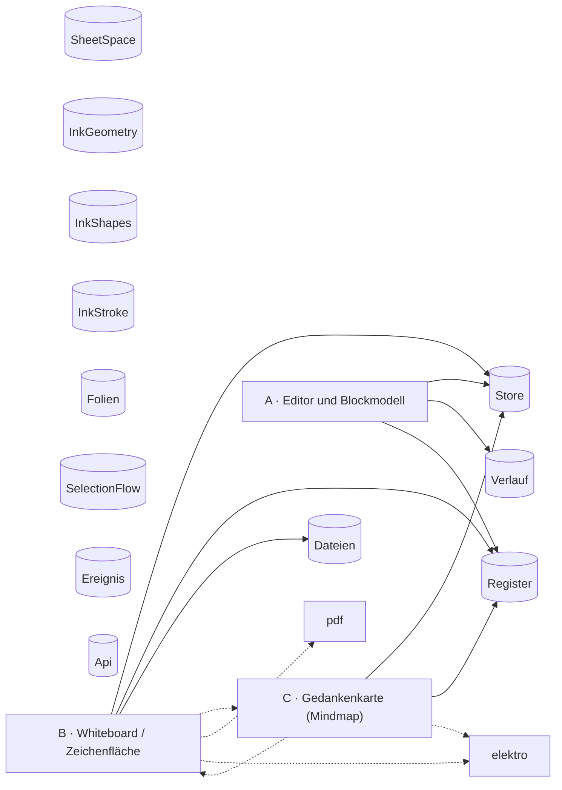

<!-- ERZEUGT — NICHT VON HAND ÄNDERN.
     Die Quelle ist doku/karte/karte.json. `node karte.mts` schreibt diese Datei neu;
     was hier von Hand geändert wird, ist beim nächsten Lauf weg. -->

# Redion — die Karte des Quelltexts

Stand 25. September 2026 · HEAD `a196b65` · 3 Systeme · 12 gemeinsame Kerne · 0 Referenzen

Gebaut beim Plattform-Audit (doku/REDION-PLATTFORM-AUDIT.md). Jeder Befund trägt Datei:Zeile; was ein Leser nicht fand, steht als „nicht gefunden“ da. Die Karte ersetzt das Lesen nicht — sie sagt, WO man lesen muss.

## Der Graph

Ein Pfeil zu einem Kern heisst: der Befund belegt, dass das System ihn BENUTZT. Ein gestrichelter Pfeil zu einem System heisst: dort liegt ein belegtes Duplikat. Was ein System nur nennt, ohne es zu benutzen, steht in seiner Notiz unter „Gemeinsam genutzt".

## Die Systeme

| Notiz | Hauptdateien | Prüfläufe | Duplikate | nutzt |
|---|---|---|---|---|
| [[editor|A · Editor und Blockmodell]] | `editor.ts`, `auswahlleiste.ts`, `mehrfach.ts` +6 | 21 | 5 | [[kern-Store|Store]], [[kern-Verlauf|Verlauf]], [[kern-Register|Register]] |
| [[zeichenflaeche|B · Whiteboard / Zeichenfläche]] | `zeichenflaeche.ts`, `werkzeuge.css`, `editor.ts` +9 | 7 | 6 | [[kern-Store|Store]], [[kern-Register|Register]], [[kern-Dateien|Dateien]] |
| [[gedankenkarte|C · Gedankenkarte (Mindmap)]] | `gedankenkarte.ts`, `werkzeuge.css`, `bloecke.ts` +4 | 4 | 7 | [[kern-Store|Store]], [[kern-Register|Register]] |

## Die gemeinsamen Kerne

| Kern | Datei | benutzt von |
|---|---|---|
| [[kern-SheetSpace|SheetSpace]] | `src/core/sheet/space.ts` | — (kein Befund belegt einen Aufruf) |
| [[kern-InkGeometry|InkGeometry]] | `src/core/ink/geometry.ts` | — (kein Befund belegt einen Aufruf) |
| [[kern-InkShapes|InkShapes]] | `src/core/ink/shapes.ts` | — (kein Befund belegt einen Aufruf) |
| [[kern-InkStroke|InkStroke]] | `src/core/ink/stroke.ts` | — (kein Befund belegt einen Aufruf) |
| [[kern-Folien|Folien]] | `src/core/slides/folien.ts` | — (kein Befund belegt einen Aufruf) |
| [[kern-Store|Store]] | `src/kern/ablage/indexdb.ts` | [[editor|A · Editor und Blockmodell]], [[zeichenflaeche|B · Whiteboard / Zeichenfläche]], [[gedankenkarte|C · Gedankenkarte (Mindmap)]] |
| [[kern-Verlauf|Verlauf]] | `src/kern/zustand/verlauf.ts` | [[editor|A · Editor und Blockmodell]] |
| [[kern-Register|Register]] | `src/register/*.ts` | [[editor|A · Editor und Blockmodell]], [[zeichenflaeche|B · Whiteboard / Zeichenfläche]], [[gedankenkarte|C · Gedankenkarte (Mindmap)]] |
| [[kern-SelectionFlow|SelectionFlow]] | `src/schale/bedienung/selection-flow.ts` | — (kein Befund belegt einen Aufruf) |
| [[kern-Ereignis|Ereignis]] | `src/kern/ereignisse/bus.ts` | — (kein Befund belegt einen Aufruf) |
| [[kern-Dateien|Dateien]] | `src/bereiche/dateien/ablage.ts` | [[zeichenflaeche|B · Whiteboard / Zeichenfläche]] |
| [[kern-Api|Api]] | `src/bereiche/verbinden/schnittstelle.ts` | — (kein Befund belegt einen Aufruf) |

## Wie die Karte gepflegt wird

Quelle ist `doku/karte/karte.json`; `node karte.mts` schreibt alle Notizen neu, `node karte.mts --pruefen` sagt nur, ob sie stimmen. Ein neuer Befund kommt ins JSON, nicht in eine Notiz. Wer ein System umbaut, trägt es dort nach — sonst lügt die Karte beim nächsten Mal.
